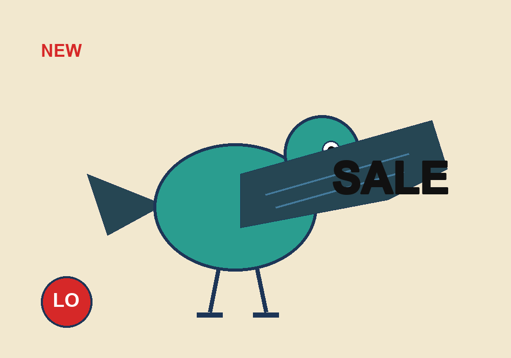
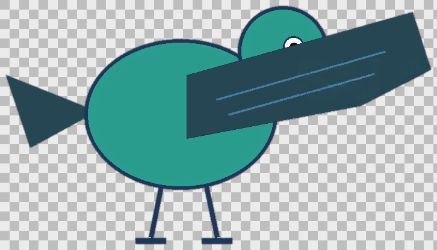

# opencode-illustration-cleanup-skill

[](https://github.com/MaxiGP0/opencode-illustration-cleanup-skill/actions/workflows/ci.yml)

[English](README.md) | [Español](README.es.md)

Una skill local de [OpenCode](https://opencode.ai) para limpiar ilustraciones con fondo plano. Quita el fondo, borra texto y logos superpuestos con inpainting LaMa basado en máscara, refina el borde del alpha y exporta un PNG transparente recortado al sujeto.

Está pensada para el caso en el que una caja rectangular de texto cruza el sujeto: enmascarar toda la caja se come el ala o el contorno y deja una muesca. Esta skill arma una máscara a nivel trazo, hace el inpainting **antes** de segmentar y, si no está segura, no borra.

| Antes | Después |
|:--:|:--:|
|  |  |

*La demo borra “SALE” del ala, mantiene el borde continuo, descarta el logo suelto y recorta al pájaro con 8 px de margen transparente.*

## Qué hace

- **Borra texto y logos** con RapidOCR + inpainting LaMa por máscara.
- **Quita el fondo** con BiRefNet vía `rembg`.
- **Refina el alpha** con feather rápido o matting closed-form.
- **Máscaras a nivel trazo**, no cajas rectangulares.
- **Fallback seguro:** si `auto` no puede aislar los trazos, saltea la región y reporta `"applied": false` en vez de arriesgar una muesca.
- **Recorte al bounding box** con padding configurable, lienzo cuadrado y filtrado de componentes aislados.
- **Lotes de carpetas**, reportes JSON, máscaras de debug y un validador determinístico.
- **Todo local:** sin APIs en la nube, sin subir imágenes, sin cuenta.

## Requisitos

- [OpenCode](https://opencode.ai) con soporte de skills.
- **Windows:** Windows 10/11 con PowerShell 5.1 o superior.
- **macOS / Linux:** `bash`, `curl` y `tar`.
- Internet en la primera ejecución.
- Unos 2,2 GB libres para Python, dependencias y los modelos por defecto.
- Alcanza con CPU. No hace falta GPU ni permisos de administrador.

La primera ejecución descarga:

| Componente | Tamaño aproximado |
|---|---:|
| `uv` + Python 3.12 + dependencias | ~1 GB |
| BiRefNet General (`birefnet-general`) | 973 MB |
| Modelo de inpainting LaMa | 206 MB |
| Modelos de RapidOCR | ~15 MB |

Si querés una primera corrida más liviana, usá `--model isnet-general-use` (179 MB) en vez de BiRefNet.

## Instalación

### Recomendada: CLI de skills de OpenCode

```bash
npx skills add MaxiGP0/opencode-illustration-cleanup-skill -g -y
```

Esto instala la skill como `illustration-cleanup` en el directorio global que usa la CLI (normalmente `~/.agents/skills/illustration-cleanup`).

### Instalador de un comando

**Windows (PowerShell):**

```powershell
Invoke-WebRequest https://raw.githubusercontent.com/MaxiGP0/opencode-illustration-cleanup-skill/main/install.ps1 -OutFile install.ps1
powershell -ExecutionPolicy Bypass -File .\install.ps1
```

O directo:

```powershell
irm https://raw.githubusercontent.com/MaxiGP0/opencode-illustration-cleanup-skill/main/install.ps1 | iex
```

**macOS / Linux:**

```bash
curl -fsSL https://raw.githubusercontent.com/MaxiGP0/opencode-illustration-cleanup-skill/main/install.sh | bash
```

Si preferís leerlo primero:

```bash
curl -fsSL https://raw.githubusercontent.com/MaxiGP0/opencode-illustration-cleanup-skill/main/install.sh -o install.sh
bash install.sh
```

### Opciones del instalador

| PowerShell | Bash | Descripción |
| --- | --- | --- |
| `-SkillDir PATH` | `--dir PATH` | Raíz de skills de OpenCode. Default: `~/.config/opencode/skills` |
| `-Ref REF` | `--ref REF` | Branch, tag o commit. Default: `main` |
| `-Force` | `--force` | Reemplazar una instalación existente |

También funciona la variable de entorno `OPENCODE_SKILLS_DIR`.

El instalador copia la skill a:

- Windows: `%USERPROFILE%\.config\opencode\skills\illustration-cleanup`
- macOS / Linux: `~/.config/opencode/skills/illustration-cleanup`

### Verificar la instalación

```powershell
.\verify.ps1
```

```bash
bash verify.sh
```

O a mano:

```bash
ls ~/.config/opencode/skills/illustration-cleanup/SKILL.md
```

Después de instalar, **abrí una sesión nueva de OpenCode** para que levante la skill.

### Instalación manual

```bash
git clone --depth 1 https://github.com/MaxiGP0/opencode-illustration-cleanup-skill.git
mkdir -p ~/.config/opencode/skills/illustration-cleanup
cp -R opencode-illustration-cleanup-skill/SKILL.md \
      opencode-illustration-cleanup-skill/scripts \
      opencode-illustration-cleanup-skill/requirements.txt \
      opencode-illustration-cleanup-skill/LICENSE \
      opencode-illustration-cleanup-skill/NOTICE \
      ~/.config/opencode/skills/illustration-cleanup/
```

En Windows, reemplazá `~/.config/opencode/skills` por `%USERPROFILE%\.config\opencode\skills`.

## Primera ejecución

El instalador solo copia la skill. La primera corrida del pipeline crea el entorno Python aislado y descarga los modelos:

```powershell
$skill = "$HOME\.config\opencode\skills\illustration-cleanup"   # install.ps1
# $skill = "$HOME\.agents\skills\illustration-cleanup"          # npx skills
powershell -NoProfile -ExecutionPolicy Bypass -File "$skill\scripts\run.ps1" --help
```

```bash
skill="$HOME/.config/opencode/skills/illustration-cleanup"
"$skill/scripts/run.sh" --help
```

Todo queda dentro de la carpeta de la skill (`tools/`, `.venv/`, `models/`). No se instala nada a nivel de sistema.

## Uso

### Cutout y limpieza básica

```powershell
$skill = "$HOME\.config\opencode\skills\illustration-cleanup"

powershell -NoProfile -ExecutionPolicy Bypass -File "$skill\scripts\run.ps1" `
  "C:\arte\ilustracion.png" `
  --output "C:\arte\salida" `
  --text-color "#111111" `
  --keep-largest
```

```bash
skill="$HOME/.config/opencode/skills/illustration-cleanup"
"$skill/scripts/run.sh" "./ilustracion.png" --output "./salida" --text-color "#111111" --keep-largest
```

### Texto sobre un ala de color

Pasá el color exacto del texto. Es la máscara más precisa:

```powershell
... --text-color "#111111" --mask-threshold 30
```

`--text-color` es repetible:

```powershell
... --text-color "#111111" --text-color "#D62828" --text-color "#FFFFFF"
```

### Logo que OCR no detecta

```powershell
... --erase-box 80,540,180,640 --text-color "#D62828"
```

Las coordenadas son `x1,y1,x2,y2` en la imagen original.

### Reparar una muesca existente

Creá un PNG en blanco y negro donde blanco sea la zona a reconstruir, y corré:

```powershell
... --no-ocr --mask "C:\arte\muesca.png" --inpaint lama --mask-expand 1 --mask-feather 1.5
```

### Bordes más suaves

```powershell
... --matting cf --force-matting
```

### Quedarse solo con el sujeto principal

```powershell
... --keep-largest
```

Esto descarta logos sueltos, polvo e islas. Para conservar elementos secundarios grandes pero descartar motas:

```powershell
... --min-component 0.02
```

### Procesar una carpeta

```powershell
... "C:\arte\carpeta" --output "C:\arte\salida" --recursive
```

### Validar el resultado

```powershell
powershell -NoProfile -ExecutionPolicy Bypass -File "$skill\scripts\validate.ps1" "C:\arte\salida\ilustracion_clean.png"
```

El validador chequea RGBA, presencia de alpha, esquinas transparentes, bbox no vacío, cobertura y márgenes.

## Opciones

| Opción | Default | Descripción |
|---|---|---|
| `--model` | `birefnet-general` | Modelo de segmentación. `isnet-anime` para estilo anime; `isnet-general-use` o `birefnet-general-lite` para una corrida más liviana. |
| `--matting` | `feather` | `feather`, `cf` (closed-form matting) o `none`. |
| `--feather` | `0.7` | Radio de feather del alpha en píxeles. |
| `--matting-max-dim` | `2048` | Arriba de este tamaño, `cf` cae a feather salvo `--force-matting`. |
| `--text-color` | ninguno | Color exacto del texto/logo en hex. Repetible. |
| `--mask-mode` | `auto` | `auto`, `kmeans`, `border`, `box`. `auto` saltea si no está seguro; `box` puede dejar muescas. |
| `--mask-threshold` | `28` | Distancia de color para la máscara de trazo. |
| `--mask-expand` | `2` | Dilata la máscara de borrado. Subilo para halos, bajalo si come borde. |
| `--mask-feather` | `1.0` | Suaviza la máscara de borrado. |
| `--erase-box` | ninguno | Caja manual `x1,y1,x2,y2`. Repetible. |
| `--mask` | ninguno | Máscara manual (blanco = borrar). |
| `--inpaint` | `auto` | `auto` intenta LaMa y cae a OpenCV; `lama`, `opencv`, `none`. |
| `--keep-largest` | off | Conservar solo el componente alpha más grande. |
| `--min-component` | `0.0` | Área mínima relativa al componente mayor (0–1). |
| `--padding` | `8` | Padding transparente alrededor del sujeto. |
| `--square` | off | Completar el recorte a un cuadrado. |
| `--alpha-threshold` | `8` | Alpha mínimo para el bbox. |
| `--despill` | off | Quitar color del fondo en bordes semitransparentes. |
| `--use-existing-alpha` | off | Usar el alpha de entrada en vez de segmentar. |
| `--no-crop` | off | Mantener el lienzo completo. |
| `--recursive` | off | Recorrer subcarpetas. |
| `--overwrite` | off | Sobrescribir salidas en vez de agregar `-1`, `-2`, etc. |
| `--json-only` | off | Imprimir solo el resumen JSON. |

## Por qué no deja una muesca

La muesca casi nunca la causa el modelo de inpainting. La causa una máscara que incluye píxeles del sujeto que no había que borrar.

- Una caja rectangular de OCR sobre “SALE” también contiene el borde del ala. Inpaintar toda la caja borra el borde.
- Este pipeline arma una máscara **a nivel trazo**. `--text-color` es el modo preciso; `auto` agrupa colores y se queda con componentes que parecen letras.
- `auto` es conservador. Si no puede aislar las letras, devuelve `auto-uncertain` / `"applied": false` y **no borra**. Ahí pasás `--text-color` o una máscara manual.
- El inpainting corre **antes** de la segmentación, así LaMa puede reconstruir el borde del ala antes de recortar.
- Si la muesca ya existe en la imagen original, enmascarás la muesca y corrés `--no-ocr --mask ...`; no segmentes alrededor.

Para ilustración plana, LaMa suele copiar color plano y líneas mejor que un modelo generativo. OpenCV Telea es un fallback; revisalo con cuidado en áreas grandes.

## Salidas

Para `ilustracion.png`:

- `ilustracion_clean.png` — PNG transparente final, recortado.
- `ilustracion_preview.png` — composite sobre checkerboard.
- `ilustracion_alpha.png` — canal alpha en grises.
- `ilustracion_erase-mask.png` — máscara de texto/logo usada para inpainting.
- `ilustracion_cleaned.png` — imagen intermedia después del inpainting.
- `batch_summary.json` — rutas, detecciones, métodos de máscara, flags `applied`, warnings y tiempos.

## Cómo funciona

1. **Detecta texto** con RapidOCR (con upscale automático en imágenes chicas).
2. **Arma la máscara** a nivel trazo. `--text-color` usa distancia de color; `auto` agrupa colores y puntúa componentes tipo letra.
3. **Inpinta** la máscara con LaMa, con fallback a OpenCV.
4. **Segmenta** la imagen limpia con BiRefNet vía rembg.
5. **Refina el alpha** con feather o matting closed-form.
6. **Filtra componentes** y recorta al bbox del sujeto.
7. **Reporta** todo y escribe máscaras de debug para revisar.

## Limitaciones

- OCR puede no detectar texto muy estilizado, manuscrito o deformado. Usá `--erase-box` o `--mask`.
- Los logos multicolor pueden necesitar máscara manual; `auto` asume que el texto es uno de los dos extremos de luminancia de la caja.
- Áreas faltantes muy grandes pueden alucinarse. Mantené la máscara pegada al texto/logo.
- Imágenes mayores a 6000 px pueden ser lentas. Usá `--matting feather` o reducilas.
- Borrar watermarks, logos o firmas puede tener implicancias legales o éticas. Confirmá que tenés derecho a editar la imagen.

## Troubleshooting

**La skill no aparece en OpenCode.** Confirmá la ruta con `verify.ps1` / `verify.sh` y abrí una sesión nueva.

**PowerShell bloquea el script.** Usá `powershell -ExecutionPolicy Bypass -File .\install.ps1` o el comando de `run.ps1` de arriba.

**Falla la descarga de un modelo.** Revisá el acceso a GitHub releases. Probá `--model isnet-general-use` para una descarga más chica.

**`applied: false` en el reporte.** `auto` no estaba seguro y salteó esa región para no dejar una muesca. Pasá el `--text-color` exacto, usá `--mask-mode border` o `--mask`.

**Queda un fantasma tenue.** Subí `--mask-expand` a `3` y volvé a correr; si persiste, usá `--mask` con una máscara un poco más grande.

**Desapareció parte del sujeto.** Bajá `--mask-expand`, subí `--mask-threshold` o usá `--text-color` / `--mask-mode kmeans`.

**El cutout incluye un logo suelto.** Agregá `--keep-largest`. Si el logo tiene que quedar, omitilo y borrá el texto con `--text-color`.

**LaMa no está disponible.** `--inpaint auto` cae a OpenCV y lo reporta en `warnings`. Usá `--inpaint lama` para forzar el error.

## Licencias y atribución

- **Esta skill:** MIT License, Copyright (c) 2026 Máximo Gomez Pessoa (MaxiGP0). Ver [LICENSE](LICENSE).
- **Software de terceros:** rembg (MIT), BiRefNet (MIT), RapidOCR (Apache-2.0), LaMa (Apache-2.0), simple-lama-inpainting (Apache-2.0), PyMatting (MIT), OpenCV (Apache-2.0), Pillow (HPND), PyTorch (BSD-3-Clause), ONNX Runtime (MIT), NumPy (BSD-3-Clause), uv (Apache-2.0), Python (PSF-2.0). Ver [NOTICE](NOTICE) para links y detalles.
- **Modelos:** los pesos de BiRefNet, LaMa y RapidOCR se descargan de sus proyectos upstream en runtime. No se redistribuyen en este repositorio.
- **OpenCode:** es un proyecto separado de sus autores. Esta skill es no oficial y no está afiliada a OpenCode ni a ningún proyecto upstream.

## Desinstalar

Borrá la carpeta instalada y todo lo que descargó:

```powershell
Remove-Item -Recurse -Force "$HOME\.config\opencode\skills\illustration-cleanup"
# o, si la instalaste con npx skills:
Remove-Item -Recurse -Force "$HOME\.agents\skills\illustration-cleanup"
```

```bash
rm -rf ~/.config/opencode/skills/illustration-cleanup
# o, si la instalaste con npx skills:
rm -rf ~/.agents/skills/illustration-cleanup
```
