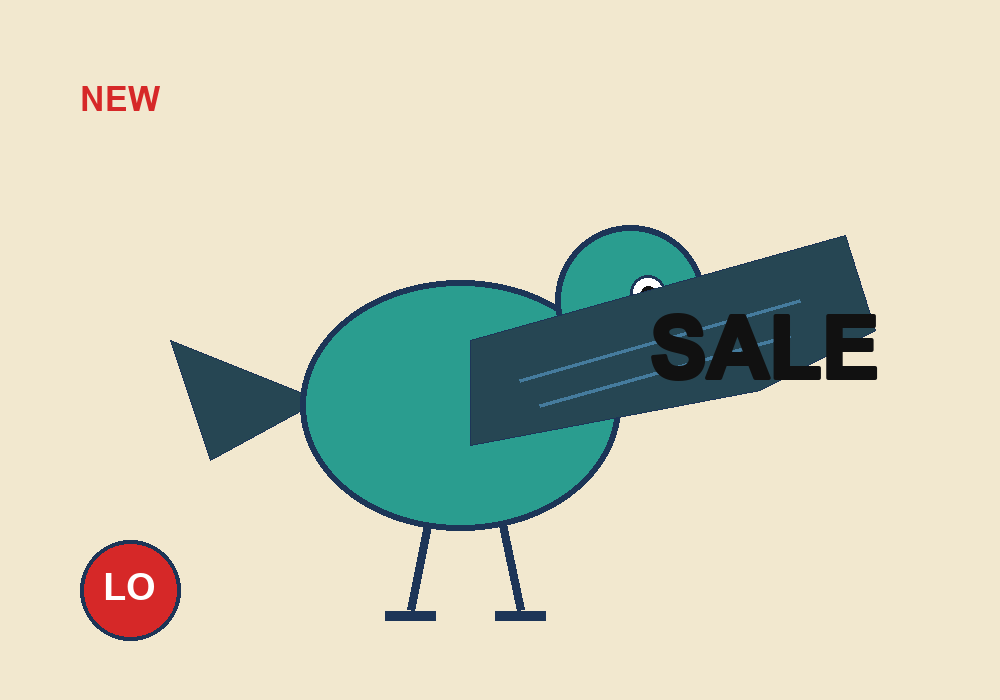
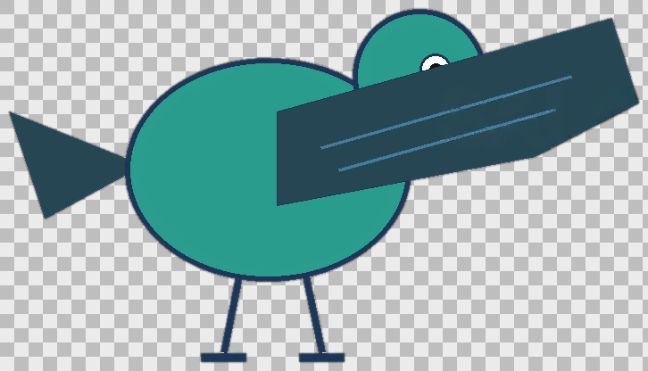

# opencode-illustration-cleanup-skill

[](https://github.com/MaxiGP0/opencode-illustration-cleanup-skill/actions/workflows/ci.yml)

[English](README.md) | [Español](README.es.md)

A local [OpenCode](https://opencode.ai) skill for cleaning flat illustrations. It removes the background, erases overlaid text and logos with mask-based LaMa inpainting, refines the alpha edge, and exports a transparent PNG cropped to the subject.

It is built for the case where a rectangular text box crosses the subject: masking the whole box eats the wing or outline and leaves a notch. This skill builds a stroke-level mask, inpaints **before** segmenting, and refuses to erase when it is not confident.

| Before | After |
|:--:|:--:|
|  |  |

*The demo removes “SALE” from the wing, keeps the wing edge continuous, drops the detached logo, and crops to the bird with an 8 px transparent margin.*

## What it does

- **Text and logo removal** with RapidOCR + mask-based LaMa inpainting.
- **Background removal** with BiRefNet via `rembg`.
- **Alpha refinement** with a fast feather or closed-form matting.
- **Stroke-level masks** instead of rectangular boxes.
- **Safe fallback:** when `auto` cannot isolate the strokes, it skips the region and reports `"applied": false` instead of risking a notch.
- **Bounding-box crop** with configurable padding, square canvas, and isolated-component filtering.
- **Batch folders**, JSON reports, debug masks, and a deterministic validator.
- **Local only:** no cloud APIs, no uploads, no account.

## Requirements

- [OpenCode](https://opencode.ai) with skills support.
- **Windows:** Windows 10/11 with PowerShell 5.1 or newer.
- **macOS / Linux:** `bash`, `curl`, and `tar`.
- Internet on the first run.
- About 3 GB free for Python, dependencies, and the default models.
- CPU is enough. No GPU, no administrator rights.

The first run downloads:

| Component | Approximate size |
|---|---:|
| `uv` + Python 3.12 + dependencies | ~1 GB |
| BiRefNet General (`birefnet-general`) | 973 MB |
| LaMa inpainting model | 206 MB |
| RapidOCR models | ~15 MB |

If you want a lighter first run, use `--model isnet-general-use` (179 MB) instead of BiRefNet.

## Install

### Recommended: OpenCode skills CLI

```bash
npx skills add MaxiGP0/opencode-illustration-cleanup-skill -g -y
```

This installs the skill as `illustration-cleanup` under the global skills directory used by the CLI (usually `~/.agents/skills/illustration-cleanup`).

### One-command installer

**Windows (PowerShell):**

```powershell
Invoke-WebRequest https://raw.githubusercontent.com/MaxiGP0/opencode-illustration-cleanup-skill/main/install.ps1 -OutFile install.ps1
powershell -ExecutionPolicy Bypass -File .\install.ps1
```

Or run it directly:

```powershell
irm https://raw.githubusercontent.com/MaxiGP0/opencode-illustration-cleanup-skill/main/install.ps1 | iex
```

**macOS / Linux:**

```bash
curl -fsSL https://raw.githubusercontent.com/MaxiGP0/opencode-illustration-cleanup-skill/main/install.sh | bash
```

Read it first if you prefer:

```bash
curl -fsSL https://raw.githubusercontent.com/MaxiGP0/opencode-illustration-cleanup-skill/main/install.sh -o install.sh
bash install.sh
```

### Installer options

| PowerShell | Bash | Description |
| --- | --- | --- |
| `-SkillDir PATH` | `--dir PATH` | OpenCode skills root. Default: `~/.config/opencode/skills` |
| `-Ref REF` | `--ref REF` | Branch, tag, or commit. Default: `main` |
| `-Force` | `--force` | Replace an existing installation |

Environment variables `OPENCODE_SKILLS_DIR` work too.

The installer copies the skill to:

- Windows: `%USERPROFILE%\.config\opencode\skills\illustration-cleanup`
- macOS / Linux: `~/.config/opencode/skills/illustration-cleanup`

### Verify the installation

```powershell
.\verify.ps1
```

```bash
bash verify.sh
```

Or check manually:

```bash
ls ~/.config/opencode/skills/illustration-cleanup/SKILL.md
```

After installing, **start a new OpenCode session** so it picks up the skill.

### Manual installation

```bash
git clone --depth 1 https://github.com/MaxiGP0/opencode-illustration-cleanup-skill.git
mkdir -p ~/.config/opencode/skills/illustration-cleanup
cp -R opencode-illustration-cleanup-skill/SKILL.md \
      opencode-illustration-cleanup-skill/scripts \
      opencode-illustration-cleanup-skill/requirements.txt \
      opencode-illustration-cleanup-skill/LICENSE \
      opencode-illustration-cleanup-skill/NOTICE \
      ~/.config/opencode/skills/illustration-cleanup/
```

On Windows, replace `~/.config/opencode/skills` with `%USERPROFILE%\.config\opencode\skills`.

## First run

The installer only copies the skill. The first pipeline run creates the isolated Python environment and downloads the models:

```powershell
$skill = "$HOME\.config\opencode\skills\illustration-cleanup"   # install.ps1
# $skill = "$HOME\.agents\skills\illustration-cleanup"          # npx skills
powershell -NoProfile -ExecutionPolicy Bypass -File "$skill\scripts\run.ps1" --help
```

```bash
skill="$HOME/.config/opencode/skills/illustration-cleanup"
"$skill/scripts/run.sh" --help
```

Everything stays inside the skill folder (`tools/`, `.venv/`, `models/`). Nothing is installed system-wide.

## Use it

### Basic cutout and cleanup

```powershell
$skill = "$HOME\.config\opencode\skills\illustration-cleanup"

powershell -NoProfile -ExecutionPolicy Bypass -File "$skill\scripts\run.ps1" `
  "C:\art\illustration.png" `
  --output "C:\art\out" `
  --text-color "#111111" `
  --keep-largest
```

```bash
skill="$HOME/.config/opencode/skills/illustration-cleanup"
"$skill/scripts/run.sh" "./illustration.png" --output "./out" --text-color "#111111" --keep-largest
```

### Text over a colored wing

Pass the exact text color. This is the most precise mask:

```powershell
... --text-color "#111111" --mask-threshold 30
```

`--text-color` is repeatable:

```powershell
... --text-color "#111111" --text-color "#D62828" --text-color "#FFFFFF"
```

### Logo that OCR does not detect

```powershell
... --erase-box 80,540,180,640 --text-color "#D62828"
```

The box coordinates are `x1,y1,x2,y2` in the source image.

### Repair an existing notch

Create a black-and-white PNG where white is the area to rebuild, then run:

```powershell
... --no-ocr --mask "C:\art\notch.png" --inpaint lama --mask-expand 1 --mask-feather 1.5
```

### Softer edges

```powershell
... --matting cf --force-matting
```

### Keep only the main subject

```powershell
... --keep-largest
```

This drops detached logos, dust, and stray islands. To keep larger secondary elements but drop specks:

```powershell
... --min-component 0.02
```

### Batch a folder

```powershell
... "C:\art\folder" --output "C:\art\out" --recursive
```

### Validate the result

```powershell
powershell -NoProfile -ExecutionPolicy Bypass -File "$skill\scripts\validate.ps1" "C:\art\out\illustration_clean.png"
```

The validator checks RGBA output, alpha presence, transparent corners, non-empty bbox, coverage, and margins.

## Options

| Option | Default | Description |
|---|---|---|
| `--model` | `birefnet-general` | Segmentation model. `isnet-anime` for anime-style art; `isnet-general-use` or `birefnet-general-lite` for a lighter run. |
| `--matting` | `feather` | `feather`, `cf` (closed-form matting), or `none`. |
| `--feather` | `0.7` | Alpha feather radius in pixels. |
| `--matting-max-dim` | `2048` | Above this size, `cf` falls back to feather unless `--force-matting`. |
| `--text-color` | none | Exact text/logo color in hex. Repeatable. |
| `--mask-mode` | `auto` | `auto`, `kmeans`, `border`, `box`. `auto` skips when unsure; `box` can leave notches. |
| `--mask-threshold` | `28` | Color distance for the stroke mask. |
| `--mask-expand` | `2` | Dilate the erase mask. Raise it for halos, lower it for eaten edges. |
| `--mask-feather` | `1.0` | Soften the erase mask. |
| `--erase-box` | none | Manual `x1,y1,x2,y2` box. Repeatable. |
| `--mask` | none | Manual mask (white = erase). |
| `--inpaint` | `auto` | `auto` tries LaMa and falls back to OpenCV; `lama`, `opencv`, `none`. |
| `--keep-largest` | off | Keep only the largest alpha component. |
| `--min-component` | `0.0` | Minimum component area relative to the largest (0–1). |
| `--padding` | `8` | Transparent padding around the subject. |
| `--square` | off | Pad the crop to a square canvas. |
| `--alpha-threshold` | `8` | Alpha threshold for the bbox. |
| `--despill` | off | Remove background color from semi-transparent edges. |
| `--use-existing-alpha` | off | Use the input alpha instead of segmenting. |
| `--no-crop` | off | Keep the full canvas. |
| `--recursive` | off | Recurse into subfolders. |
| `--overwrite` | off | Overwrite existing outputs instead of adding `-1`, `-2`, etc. |
| `--json-only` | off | Print only the JSON summary. |

## Why it does not leave a notch

A notch is almost never the inpainting model's fault. It comes from a mask that includes pixels of the subject that should not be erased.

- A rectangular OCR box over “SALE” also contains the wing edge. Inpainting the whole box deletes the edge.
- This pipeline builds a **stroke-level** mask. `--text-color` is the precise mode; `auto` groups colors and keeps letter-like components.
- `auto` is conservative. If it cannot isolate the letters, it returns `auto-uncertain` / `"applied": false` and **does not erase**. You then pass `--text-color` or a manual mask.
- Inpainting runs **before** segmentation, so LaMa can rebuild the wing edge before the cutout is made.
- If the notch already exists in the source, mask the notch itself and run with `--no-ocr --mask ...`; do not segment around it.

For flat illustrations, LaMa usually copies flat color and line work better than a generative model. OpenCV Telea is a fallback; inspect it carefully on large missing areas.

## Outputs

For `illustration.png`:

- `illustration_clean.png` — final transparent, cropped PNG.
- `illustration_preview.png` — composite on a checkerboard.
- `illustration_alpha.png` — alpha channel as grayscale.
- `illustration_erase-mask.png` — text/logo mask used for inpainting.
- `illustration_cleaned.png` — intermediate image after inpainting.
- `batch_summary.json` — paths, detections, mask methods, `applied` flags, warnings, and timings.

## How it works

1. **Detect text** with RapidOCR (auto-upscaled on small images).
2. **Build a mask** at stroke level. `--text-color` uses color distance; `auto` clusters colors and scores letter-like components.
3. **Inpaint** the mask with LaMa, with an OpenCV fallback.
4. **Segment** the cleaned image with BiRefNet via rembg.
5. **Refine alpha** with feather or closed-form matting.
6. **Filter components** and crop to the subject bbox.
7. **Report** everything and write debug masks for review.

## Limitations

- OCR may miss very stylized, handwritten, or distorted text. Use `--erase-box` or `--mask`.
- Multi-color logos may need a manual mask; `auto` assumes the text is one of the two luminance extremes in the box.
- Very large missing areas may be hallucinated. Keep the mask tight around the text/logo.
- Images larger than 6000 px can be slow. Use `--matting feather` or downscale.
- Removing watermarks, logos, or signatures may have legal or ethical implications. Confirm you have the right to edit the image.

## Troubleshooting

**The skill does not appear in OpenCode.** Confirm the path with `verify.ps1` / `verify.sh`, then start a new session.

**PowerShell blocks the script.** Use `powershell -ExecutionPolicy Bypass -File .\install.ps1` or the `run.ps1` command shown above.

**The model download fails.** Check access to GitHub releases. Try `--model isnet-general-use` for a smaller download.

**`applied: false` in the report.** `auto` was not confident and skipped that region to avoid a notch. Pass the exact `--text-color`, use `--mask-mode border`, or use `--mask`.

**A faint ghost remains.** Raise `--mask-expand` to `3` and re-run; if it persists, use `--mask` with a slightly larger stroke mask.

**Part of the subject disappeared.** Lower `--mask-expand`, raise `--mask-threshold`, or use `--text-color` / `--mask-mode kmeans`.

**The cutout includes a detached logo.** Add `--keep-largest`. If the logo should stay, omit it and remove the text with `--text-color` instead.

**LaMa is not available.** `--inpaint auto` falls back to OpenCV and reports it in `warnings`. Use `--inpaint lama` to force the error.

## Licenses and attribution

- **This skill:** MIT License, Copyright (c) 2026 Máximo Gomez Pessoa (MaxiGP0). See [LICENSE](LICENSE).
- **Third-party software:** rembg (MIT), BiRefNet (MIT), RapidOCR (Apache-2.0), LaMa (Apache-2.0), simple-lama-inpainting (Apache-2.0), PyMatting (MIT), OpenCV (Apache-2.0), Pillow (HPND), PyTorch (BSD-3-Clause), ONNX Runtime (MIT), NumPy (BSD-3-Clause), uv (Apache-2.0), Python (PSF-2.0). See [NOTICE](NOTICE) for links and details.
- **Models:** BiRefNet, LaMa, and RapidOCR weights are downloaded from their upstream projects at runtime. They are not redistributed in this repository.
- **OpenCode:** a separate project by its authors. This skill is unofficial and not affiliated with OpenCode or any upstream project.

## Uninstall

Remove the installed skill folder and everything it downloaded:

```powershell
Remove-Item -Recurse -Force "$HOME\.config\opencode\skills\illustration-cleanup"
# or, if installed with npx skills:
Remove-Item -Recurse -Force "$HOME\.agents\skills\illustration-cleanup"
```

```bash
rm -rf ~/.config/opencode/skills/illustration-cleanup
# or, if installed with npx skills:
rm -rf ~/.agents/skills/illustration-cleanup
```
